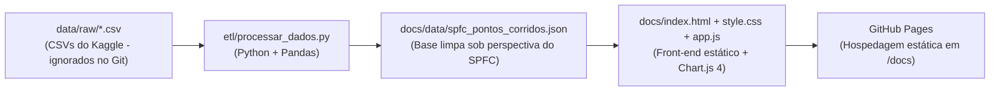

<div align="center">

# Dados Tricolor

**Painel interativo de análise estatística do São Paulo Futebol Clube no Campeonato Brasileiro na era dos pontos corridos (2003–2025).**

[](https://yurialvvvss.github.io/SPFC-Analytics/)
[](https://www.python.org/)
[](https://pandas.pydata.org/)
[](https://www.chartjs.org/)
[](#arquitetura)

[Acessar o painel (GitHub Pages)](https://yurialvvvss.github.io/SPFC-Analytics/) · [Funcionalidades](#funcionalidades) · [Pipeline ETL](#qualidade-de-dados-e-etl) · [Como executar](#como-executar-localmente)

</div>

---

## Sobre o Projeto

O **Dados Tricolor** transforma os arquivos brutos do Campeonato Brasileiro (Kaggle) em uma aplicação web **100% estática** — sem backend, pronta para hospedagem gratuita no GitHub Pages — focada exclusivamente na trajetória do **São Paulo FC** desde a implantação dos pontos corridos em 2003 até 2025.

Um pipeline em **Python + Pandas** limpa, integra e padroniza as partidas sob a perspectiva do Tricolor, exportando um único arquivo JSON otimizado (`docs/data/spfc_pontos_corridos.json`) consumido em tempo real por um front-end em **HTML5, CSS3 e JavaScript puro**.

---

## Resumo da Base (2003–2025)

| Indicador | Valor | Cobertura |
| --- | --- | --- |
| **Partidas analisadas** | **894 jogos** (23 temporadas) | 2003–2025 |
| **Campanha geral** | **396V · 246E · 252D** (`53,5%` de aproveitamento) | 2003–2025 |
| **Gols** | **1.259 GP · 969 GC** (Saldo **+290**) | 2003–2025 |
| **Disciplina (SPFC)** | **1.096 amarelos** (`2,40/J`) · **53 vermelhos** (`0,12/J`) | 2014–2025 (456 jogos) |
| **Gols detalhados** | **570 gols** (`563` de 117 atletas + `7` gols contra a favor) | 2014–2025 (456 jogos) |
| **Estatísticas técnicas** | Chutes, posse de bola, passes, faltas e escanteios | 379 jogos |

---

## Funcionalidades

### Filtros Dinâmicos Combináveis
- **Temporada (única ou intervalo):** seletores `De` / `Até` (`2003`–`2025`) + atalhos rápidos (`Todas`, `Tri 06–08`, `Com Gols/Cartões 14–25`, `Últimos 5 anos` e `2025`).
- **Adversário + Atalhos de Clássicos:** seleção de qualquer um dos 45 adversários enfrentados ou pílulas rápidas para **Todos os Clássicos**, **Corinthians**, **Palmeiras** e **Santos**.
- **Mando de Campo:** controle segmentado `Todos` | `Casa` | `Fora`.
- **Responsividade inteligente:** barra de filtros fixa (`sticky`) no desktop e no fluxo normal da página no mobile para não cobrir os gráficos.

### Indicadores (KPIs)
- **Partidas** (total e divisão Casa/Fora), **Aproveitamento (%)** (com pontos conquistados vs. disputados), **Retrospecto V/E/D** (com barra proporcional), **Gols & Saldo** e **Disciplina**.
- **Cálculo rigoroso de disciplina:** as médias de cartões por jogo consideram **exclusivamente** partidas com cobertura disciplinar (`2014–2025`) dentro do recorte filtrado, evitando distorções quando anos de `2003–2013` estão selecionados.
- **Tratamento completo de estados vazios:** combinações sem jogos retornam estados amigáveis, sem `NaN%` e sem erros de renderização nos gráficos.

### Gráficos Interativos (Chart.js 4)
1. **Evolução por Temporada / Rodada a Rodada:** barras empilhadas de V/E/D + linha de aproveitamento (%) com destaque ao Tricampeonato (`2006–2008`) e aba alternativa de **Gols Pró vs. Contra**. Clicar em qualquer temporada abre automaticamente a visão **Campanha Rodada a Rodada** daquele ano.
2. **Desempenho por Mando (Casa vs. Fora):** comparativo percentual de aproveitamento, vitórias e jogos sem sofrer gol (*clean sheets*), acompanhado de resumo numérico.
3. **Top 10 Artilheiros Dinâmico:** recalculado instantaneamente a partir dos gols de cada partida filtrada, diferenciando gols de bola rolando e pênaltis e excluindo gols contra da artilharia individual.
4. **Disciplina & Retrospecto por Adversário:** aba com evolução anual de amarelos/jogo e expulsões do SPFC (2014–2025) e aba clicável com o aproveitamento frente aos adversários mais frequentes do recorte.

### Tabela de Partidas Filtradas
- Busca textual instantânea (adversário, artilheiro, estádio ou técnico), filtro rápido por resultado (`V`/`E`/`D`), ordenação por coluna, paginação configurável (`15`/`25`/`50`), cartões e linha do tempo de gols com minutos e marcações `(P)` e `(GC)`.

---

## Arquitetura



---

## Estrutura do Projeto

```text
SPFC-Analytics/
├── data/
│   └── raw/                             # CSVs originais do Kaggle (ignorados no .gitignore)
│       └── .gitkeep
├── etl/
│   └── processar_dados.py               # Pipeline de limpeza, integração e exportação JSON
├── docs/                                # Raiz publicada pelo GitHub Pages
│   ├── index.html                       # Página principal do painel
│   ├── css/
│   │   └── style.css                    # Identidade visual Tricolor e layout responsivo
│   ├── js/
│   │   └── app.js                       # Estado reativo, filtros, KPIs, Chart.js e tabela
│   └── data/
│       └── spfc_pontos_corridos.json    # Dataset limpo gerado pelo ETL
├── .gitignore
└── README.md
```

---

## Qualidade de Dados e ETL

O script [`etl/processar_dados.py`](etl/processar_dados.py) aplica validações e correções específicas identificadas na inspeção dos arquivos originais:

- **Padronização de nomes:** os CSVs originais trazem os clubes sem acento (`Sao Paulo`, `Ceara`, `Gremio`, `Vitoria`). O ETL filtra `Sao Paulo` e padroniza todos os clubes com acentuação em português para exibição.
- **Ajuste de calendário (Edição 2020):** as 11 partidas finais do Brasileirão 2020 (rodadas 28 a 38), disputadas em janeiro e fevereiro de 2021 devido à pandemia, são atribuídas à temporada `2020`, preservando exatamente 38 jogos em 2020 e 38 em 2021.
- **Integração híbrida de cartões (2014–2025):** utiliza `campeonato-brasileiro-cartoes.csv` para **2014–2024** (mais completo, cobrindo 2014, 2024 e o 1º amarelo em expulsões por segundo amarelo) e faz *fallback* automático para `campeonato-brasileiro-estatisticas-full.csv` em **2025**. Para `2003–2013`, exporta `null` para evitar falsos zeros.
- **Artilharia limpa e dinâmica:** salva os gols dentro de cada partida (`2014–2025`), ordenados cronologicamente (incluindo acréscimos como `45+8` e `90+8`), unifica nomes duplicados entre temporadas (ex.: `Aldemir Ferreira` + `Ferreirinha` → `Ferreirinha`; `Diego Henrique Costa Barbosa` + `Diego Costa` → `Diego Costa`) e sinaliza gols contra a favor do SPFC (`gol_contra: true`) para não entrarem na artilharia individual.
- **Higienização textual:** remove espaços inseparáveis (`\xa0`) em nomes de estádios (ex.: `Morumbi`) e corrige problemas de codificação (*mojibake* UTF-8/Latin-1) em nomes de técnicos.

---

## Como Executar Localmente

### 1. Visualizar o painel (sem precisar rodar o ETL)

O JSON processado já está versionado em `docs/data/spfc_pontos_corridos.json`. Basta subir um servidor HTTP estático apontando para `docs/`:

```bash
git clone https://github.com/YuriAlvvvss/SPFC-Analytics.git
cd SPFC-Analytics
python -m http.server 8000 --directory docs
```

Depois acesse **`http://localhost:8000/`** no navegador.

> **Dica:** evite abrir `docs/index.html` diretamente via `file://`, pois navegadores bloqueiam chamadas `fetch()` para arquivos locais por política de CORS.

### 2. Reexecutar o ETL com dados novos do Kaggle

1. Baixe os CSVs do dataset **Campeonato Brasileiro de Futebol** no Kaggle e coloque-os em `data/raw/`:
   - `campeonato-brasileiro-full.csv`
   - `campeonato-brasileiro-cartoes.csv`
   - `campeonato-brasileiro-estatisticas-full.csv`
   - `campeonato-brasileiro-gols.csv`
2. Instale o Pandas (se ainda não estiver instalado) e execute o script:

```bash
pip install pandas
python etl/processar_dados.py
```

O script regenerará `docs/data/spfc_pontos_corridos.json` e exibirá no terminal o resumo completo de validação.

---

## Publicação no GitHub Pages

1. Faça push da branch `main` com a pasta `docs/` atualizada.
2. No repositório do GitHub, acesse **Settings → Pages**.
3. Em **Build and deployment**, selecione **Source: Deploy from a branch**, escolha a branch **`main`** e a pasta **`/docs`**, e clique em **Save**.

Em poucos instantes o painel estará online em `https://yurialvvvss.github.io/SPFC-Analytics/`.

---

## Fonte dos Dados

Os dados brutos são provenientes do dataset público do **Campeonato Brasileiro de Futebol** disponível no [Kaggle](https://www.kaggle.com/datasets/adaoduque/campeonato-brasileiro-de-futebol). Os arquivos CSV originais não são versionados no repositório (ignorados via `.gitignore` em `data/raw/`), mantendo o histórico leve e limpo.
