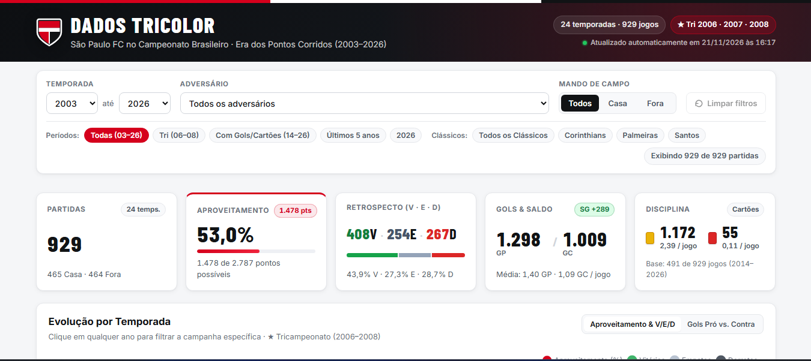
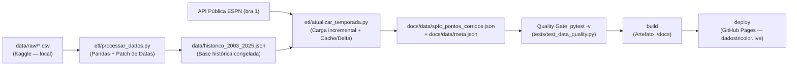

<div align="center">

# Dados Tricolor

**Painel interativo de análise estatística do São Paulo Futebol Clube no Campeonato Brasileiro na era dos pontos corridos (2003–Atual).**

**Acesso em produção:** [dadostricolor.live](https://dadostricolor.live/)

[](https://github.com/YuriAlvvvss/SPFC-Analytics/actions/workflows/data-quality.yml)
[](https://github.com/YuriAlvvvss/SPFC-Analytics/actions/workflows/atualizar-jogos.yml)

[](https://dadostricolor.live/)
[](https://www.python.org/)
[](https://pandas.pydata.org/)
[](tests/test_data_quality.py)
[](https://www.chartjs.org/)

[Acessar o painel](https://dadostricolor.live/) · [Funcionalidades](#funcionalidades) · [Engenharia de Dados e CI/CD](#engenharia-de-dados-qualidade-e-cicd) · [Estrutura do Projeto](#estrutura-do-projeto) · [Como Executar](#como-executar-localmente) · [Fonte dos Dados](#fonte-dos-dados)

[](https://dadostricolor.live/)

</div>

---

## Sobre o Projeto

O **Dados Tricolor** é uma aplicação web **100% estática** — construída em **HTML5, CSS3, JavaScript puro e Chart.js 4** e publicada no GitHub Pages em [dadostricolor.live](https://dadostricolor.live/) — focada na trajetória do **São Paulo FC** no Campeonato Brasileiro Série A na era dos pontos corridos (**2003–Atual**).

O projeto opera com uma **arquitetura híbrida de dados protegida por testes automatizados**:
- **Base histórica congelada (2003–2025):** estruturada em **Python + Pandas** a partir dos CSVs públicos do Campeonato Brasileiro (Kaggle) e versionada em `data/historico_2003_2025.json`.
- **Carga incremental automatizada (2026+):** pipeline em **Python + `requests`** executado via **GitHub Actions** que consulta a **API pública da ESPN (`bra.1`)**, mescla os jogos finalizados ao histórico congelado e atualiza `docs/data/spfc_pontos_corridos.json` e `docs/data/meta.json`.
- **Quality Gate contínuo:** toda atualização de dados ou push na `main` passa pela suíte `pytest` em `tests/test_data_quality.py` antes de qualquer commit automatizado ou publicação no GitHub Pages.

---

## Resumo da Base Histórica Congelada (2003–2025)

| Indicador | Valor | Cobertura |
| --- | --- | --- |
| **Partidas analisadas** | **894 jogos** (23 temporadas) | 2003–2025 |
| **Campanha geral** | **396V · 246E · 252D** (`53,5%` de aproveitamento) | 2003–2025 |
| **Gols** | **1.259 GP · 969 GC** (Saldo **+290**) | 2003–2025 |
| **Disciplina (SPFC)** | **1.096 amarelos** (`2,40/J`) · **53 vermelhos** (`0,12/J`) | 2014–2025 (456 jogos) |
| **Gols detalhados** | **570 gols** (`563` de 117 atletas + `7` gols contra a favor) | 2014–2025 (456 jogos) |
| **Estatísticas técnicas** | Chutes, posse de bola, passes, faltas e escanteios | 379 jogos |

> **Temporada atual (`2026+`):** os jogos finalizados da edição em andamento são anexados automaticamente a essa base congelada pelo workflow do GitHub Actions (segundas e sextas-feiras às 08h BRT, além de disparo manual). Os totais atualizados e a data/hora da última sincronização em horário de Brasília são exibidos diretamente no painel via `docs/data/meta.json`.

---

## Funcionalidades

### Filtros Dinâmicos e Compartilháveis via URL
- **Limites calculados a partir dos dados:** ano máximo, subtítulo, seletores `De`/`Até`, chips de período (`Todas`, `Tri (06–08)`, `Com Gols/Cartões`, `Últimos 5 anos` e temporada atual), lista de adversários (com atalhos para **Todos os Clássicos**, **Corinthians**, **Palmeiras** e **Santos**) e mando de campo (`Todos` | `Casa` | `Fora`) são populados dinamicamente.
- **Sincronização bidirecional via `URLSearchParams`:** alterar filtros atualiza a URL em tempo real via `history.replaceState` (omitindo parâmetros com valor padrão), e abrir uma URL parametrizada restaura automaticamente o recorte filtrado.
- **Fallback seguro:** parâmetros inválidos, temporadas inexistentes ou query strings malformadas são ignorados sem quebrar a renderização; se `de > ate`, o intervalo é normalizado automaticamente.
- **Botão de copiar link (`Copiar link`):** sincroniza o estado atual, copia a URL completa via Clipboard API (com fallback para ambientes sem permissão) e exibe confirmação visual (`Link copiado!`).
- **Parâmetros suportados na URL:**

| Parâmetro | Valores aceitos | Exemplo |
| --- | --- | --- |
| `de` / `ate` | Ano da temporada (`YYYY`) presente na base | `de=2006&ate=2008` |
| `adversario` | Nome do clube (aceita grafia sem acento/maiúsculas) ou `CLASSICOS` | `adversario=CLASSICOS` |
| `mando` | `Casa` ou `Fora` | `mando=Casa` |
| `resultado` | Filtro rápido da tabela (`V`, `E` ou `D`) | `resultado=V` |
| `busca` | Termo de busca na tabela (até 120 caracteres) | `busca=Luciano` |

Exemplo de link compartilhável (Tricampeonato contra clássicos como mandante):

```text
https://dadostricolor.live/?de=2006&ate=2008&adversario=CLASSICOS&mando=Casa
```

### Indicadores (KPIs)
- **Partidas** (total e divisão Casa/Fora), **Aproveitamento (%)** (pontos conquistados vs. disputados), **Retrospecto V/E/D** (com barra proporcional), **Gols & Saldo** e **Disciplina**.
- **Cálculo rigoroso de disciplina:** as médias de cartões por jogo consideram exclusivamente partidas com cobertura disciplinar (`2014–Atual`), evitando distorções quando anos de `2003–2013` estão no recorte.
- **Tratamento de estados vazios:** combinações sem jogos exibem mensagens claras, sem `NaN%` nem falhas de renderização.

### Recordes e Sequências (Streaks)
Seção recalculada dinamicamente em ordem cronológica a cada alteração nos filtros globais, exibindo o total de jogos analisados e 6 cards:
- **Maior Invencibilidade:** maior sequência sem derrotas (`V`/`E`), com período e indicador de marcas igualadas.
- **Maior Sequência de Vitórias:** maior série consecutiva de triunfos, com período e contagem de empates na marca.
- **Maior Jejum sem Vencer:** maior período consecutivo sem vitória (`E`/`D`).
- **Sequência Recente:** momento no encerramento do recorte (vitórias seguidas, jogos invicto, derrotas seguidas ou jejum), com destaque do último placar e adversário.
- **Maior Goleada a Favor:** vitória com maior saldo de gols (desempate por mais gols pró e data mais recente), exibindo placar, saldo, adversário, data e mando.
- **Pior Derrota:** derrota com pior saldo de gols (desempate por mais gols sofridos e data mais recente), exibindo placar, saldo, adversário, data e mando.

### Gráficos Interativos (Chart.js 4)
1. **Evolução por Temporada / Campanha Rodada a Rodada:** barras empilhadas de V/E/D + linha de aproveitamento (%) com destaque ao Tricampeonato (`2006–2008`) e aba **Gols Pró vs. Contra**. Clicar em qualquer ano alterna para a visão rodada a rodada.
2. **Desempenho por Mando (Casa vs. Fora):** comparativo percentual de aproveitamento, vitórias e jogos sem sofrer gol (*clean sheets*), com resumo numérico.
3. **Top 10 Artilheiros Dinâmico:** recalculado a partir dos gols de cada partida filtrada, diferenciando gols de bola rolando e pênaltis e excluindo gols contra da artilharia individual.
4. **Disciplina & Retrospecto por Adversário:** alternância entre a evolução anual de cartões (`2014–Atual`) e o aproveitamento frente aos até 15 adversários mais frequentes do recorte (com clique na barra para filtrar o clube).

### Comparador de Temporadas Lado a Lado
Módulo independente dos filtros globais (consulta sempre a base histórica completa), permitindo confrontar quaisquer duas campanhas:
- **Controles dedicados:** seletores de **Temporada A** e **Temporada B** (iniciando pelas duas edições mais recentes, com selo `★ Campeão` em `2006`, `2007` e `2008`), botão **Inverter (`⇄`)** e filtro próprio de mando (`Todos` | `Casa` | `Fora`).
- **Tabela comparativa com polaridade correta (12 indicadores + `Δ`):**
  - *Maior é melhor:* Pontos conquistados, Aproveitamento (%), Vitórias, Gols Pró, Média de Gols Pró/jogo, Saldo de Gols e Jogos sem sofrer gol (com taxa percentual).
  - *Menor é melhor (`↓`):* Derrotas, Gols Contra e Média de Gols Contra/jogo.
  - *Neutros:* Jogos disputados e Empates.
- **Resumo de vantagem e avisos contextuais:** contabiliza quantas métricas comparáveis cada temporada lidera e alerta quando a mesma temporada está selecionada nos dois lados (estado neutro `=`) ou quando há diferença no total de jogos entre as edições (ex.: 46 jogos em 2003–2004, 42 em 2005, 38 a partir de 2006 ou temporada em andamento).
- **Gráfico de Pontos Acumulados (Jogo a Jogo):** curva comparativa em **Chart.js 4** alinhada cronologicamente (`J1`, `J2`, ...), com interrupção natural da série mais curta (`null` / `spanGaps: false`) e tooltips exibindo placar, adversário, rodada e diferença de pontos naquele jogo.

### Tabela de Partidas Filtradas
- Busca textual instantânea (adversário, artilheiro, estádio, técnico ou temporada), filtro rápido por resultado (`V`/`E`/`D`), ordenação por coluna, paginação (`15`/`25`/`50`), cartões disciplinares e linha do tempo de gols com minutos e marcações `(P)` e `(GC)`.
- **Selo de sincronização:** exibe no cabeçalho e no rodapé a data/hora da última atualização automática em BRT lida de `docs/data/meta.json`.

---

## Engenharia de Dados, Qualidade e CI/CD



### 1. ETL Histórico ([`etl/processar_dados.py`](etl/processar_dados.py))
Processa os CSVs originais do Kaggle (`2003–2025`) sob a perspectiva do São Paulo FC e gera `data/historico_2003_2025.json` sincronizado com `docs/data/spfc_pontos_corridos.json` (preservando partidas `2026+` existentes e utilizando escrita atômica com `allow_nan=False`):
- **Patch documentado de datas (`CORRECOES_DATAS_POR_ID`):** corrige no próprio pipeline duas anomalias de datas duplicadas presentes na fonte original do Kaggle, **sem alterar os arquivos brutos em `data/raw/`**:
  - ID `2417` (2008 R11, Casa vs Palmeiras): `2008-07-06` → `2008-07-13`.
  - ID `3130` (2010 R5, Fora vs Guarani): `2010-05-23` → `2010-05-30`.
  - As partidas são reordenadas cronologicamente por `(temporada, data, id)`. A flag `--patch-json` permite aplicar o patch diretamente sobre a base versionada sem precisar dos CSVs do Kaggle nem do `pandas`.
- **Padronização e higiene:** acentua nomes de clubes, unifica nomes de atletas entre temporadas e súmulas (ex.: `Aldemir Ferreira` → `Ferreirinha`; `Diego Henrique Costa Barbosa` → `Diego Costa`), sinaliza gols contra a favor (`gol_contra: true`), remove `\xa0` em estádios e corrige *mojibake* UTF-8/Latin-1 em técnicos.
- **Calendário 2020 e cobertura híbrida de cartões:** atribui as 11 rodadas finais da edição 2020 (disputadas em jan–fev/2021) à temporada `2020`; usa `campeonato-brasileiro-cartoes.csv` para `2014–2024` com fallback para `campeonato-brasileiro-estatisticas-full.csv` em `2025` e `null` para `2003–2013`.

### 2. ETL Incremental ([`etl/atualizar_temporada.py`](etl/atualizar_temporada.py))
Atualiza a temporada corrente (`2026+`) preservando 100% do schema histórico:
- **Cache/Delta:** consulta `/summary?event={id}` na API da ESPN (`bra.1`) apenas para partidas novas ou incompletas (suporta `--force-refresh` para reconsulta total).
- **Normalização e proteção *fail-safe*:** mapeia clubes, atletas e estádios (`MAPA_TIMES`, `MAPA_ATLETAS`, `MAPA_ARENAS`) para o padrão histórico, converte datas para `America/Sao_Paulo` (BRT), aborta com erro em caso de falha da API ou regressão na contagem de partidas e grava `docs/data/spfc_pontos_corridos.json` e `docs/data/meta.json` de forma atômica (apenas quando há mudança real).

### 3. Testes de Qualidade de Dados ([`tests/test_data_quality.py`](tests/test_data_quality.py))
Suíte automatizada em **`pytest`** que valida simultaneamente `docs/data/spfc_pontos_corridos.json`, `data/historico_2003_2025.json` e `docs/data/meta.json`:

| Categoria | Validações executadas |
| --- | --- |
| **Integridade de arquivos** | Existência, tamanho `> 0`, UTF-8 limpo (sem BOM ou `U+FFFD`), JSON estrito (rejeita `NaN`/`Infinity`) e estrutura raiz (`metadata` + `partidas`). |
| **Schema e nulos** | Presença exata de todas as chaves de `metadata`, `meta.json` e das 29 chaves de cada partida; nenhum campo obrigatório nulo, vazio ou `NaN`; cobertura obrigatória de gols e cartões a partir de `2014`. |
| **Regras de domínio do futebol** | Datas `YYYY-MM-DD` e horas `HH:MM` entre `2003` e hoje (incluindo a exceção da temporada `2020` em jan–fev/2021), ordenação cronológica por `(temporada, data, id)`, limites de rodadas por edição (46 em 2003–2004, 42 em 2005, 38 em 2006+), UFs válidas e consistentes por clube, ausência de duplicatas ortográficas ou SPFC contra si mesmo, higiene de strings e faixas válidas de cartões/estatísticas (`chutes_no_alvo <= chutes`, percentuais `0..100`). |
| **Coerência de placar e gols** | `gols_pro` e `gols_contra` inteiros `>= 0` batendo exatamente com `saldo_gols`, `resultado` (`V`/`E`/`D`) e `pontos` (`3`/`1`/`0`); quando `gols` está presente, `len(gols) == gols_pro`, minutos válidos em ordem cronológica e coerência entre `tipo` e `gol_contra`. |
| **Unicidade e consistência cruzada** | Sem duplicidade por `id`, `(temporada, rodada)`, `(data, adversario)` ou `(temporada, mando, adversario)`; no máximo 1 jogo do SPFC por data; integridade entre `metadata`, `docs/data/meta.json` e preservação intacta do histórico `2003–2025` no arquivo de produção. |

### 4. Quality Gate e Deploy no GitHub Actions
- **Pipeline de Qualidade e Deploy ([`.github/workflows/data-quality.yml`](.github/workflows/data-quality.yml)):** acionado em `push` e `pull_request` na branch `main` (além de `workflow_dispatch`), estruturado em **3 jobs encadeados**:
  1. **`data-quality`:** configura Python 3.12, instala `requirements.txt` e executa `pytest -v`. Qualquer violação nos dados falha o job e interrompe o pipeline.
  2. **`build`** (`needs: data-quality`, apenas em `push` na `main`): empacota `./docs` como artefato do GitHub Pages (`actions/configure-pages@v5` + `actions/upload-pages-artifact@v3`).
  3. **`deploy`** (`needs: build`, apenas em `push` na `main`): publica o artefato aprovado no ambiente `github-pages` (`actions/deploy-pages@v4`), impedindo automaticamente que dados corrompidos cheguem à produção.
- **Sincronização Agendada ([`.github/workflows/atualizar-jogos.yml`](.github/workflows/atualizar-jogos.yml)):** roda às segundas e sextas-feiras às 08h BRT (`cron: "0 11 * * 1,5"`) e sob demanda; executa `etl/atualizar_temporada.py`, roda o **Quality Gate (`pytest -v`)** e só realiza commit/push em `docs/data/` se todos os testes passarem e houver alteração real nos dados.

---

## Estrutura do Projeto

```text
SPFC-Analytics/
├── .github/
│   └── workflows/
│       ├── atualizar-jogos.yml          # Carga incremental agendada (Seg/Sex 08h BRT) + Quality Gate
│       └── data-quality.yml             # Pipeline CI/CD em 3 jobs: data-quality -> build -> deploy
├── data/
│   ├── historico_2003_2025.json         # Base histórica congelada (versionada no Git)
│   └── raw/                             # CSVs originais do Kaggle (ignorados no .gitignore)
│       └── .gitkeep
├── docs/                                # Raiz empacotada e publicada no GitHub Pages
│   ├── CNAME                            # Domínio personalizado (dadostricolor.live)
│   ├── assets/
│   │   └── preview.png                  # Preview visual do painel
│   ├── css/
│   │   └── style.css                    # Identidade visual Tricolor e layout responsivo
│   ├── data/
│   │   ├── meta.json                    # Metadados da última sincronização (BRT) e contagens
│   │   └── spfc_pontos_corridos.json    # Dataset de produção (2003–Atual) consumido pelo site
│   ├── index.html                       # Página principal do painel
│   └── js/
│       └── app.js                       # Filtros/URL, streaks, comparador, Chart.js 4 e tabela
├── etl/
│   ├── atualizar_temporada.py           # Carga incremental da temporada atual via API ESPN
│   └── processar_dados.py               # ETL histórico (Kaggle CSVs -> 2003–2025) e patch de datas
├── tests/
│   └── test_data_quality.py             # Suíte pytest de qualidade e integridade dos dados
├── .gitignore
├── README.md
└── requirements.txt                     # Dependências Python (requests e pytest)
```

---

## Como Executar Localmente

### 1. Clonar o repositório e instalar dependências

```bash
git clone https://github.com/YuriAlvvvss/SPFC-Analytics.git
cd SPFC-Analytics
pip install -r requirements.txt
```

### 2. Subir o servidor HTTP local (Front-end)

Os JSONs de produção já estão versionados em `docs/data/`. Sirva a pasta `docs/` via HTTP local:

```bash
python3 -m http.server 8000 --directory docs
```

Acesse **`http://localhost:8000/`** no navegador.

> **Por que usar um servidor HTTP local?** Abrir `docs/index.html` diretamente via `file://` faz navegadores bloquearem chamadas `fetch()` por política de CORS. Servir em `http://localhost:8000` (contexto seguro) garante tanto o carregamento dos datasets quanto o funcionamento completo da sincronização de URL (`URLSearchParams` / `history.replaceState`) e do botão **Copiar link** (Clipboard API).

### 3. Executar a suíte de testes de qualidade de dados

```bash
pytest -v
```

### 4. Executar os pipelines de ETL

- **Atualização incremental da temporada atual (API ESPN):**

```bash
python3 etl/atualizar_temporada.py
# Opcional: reconsultar todos os jogos da temporada atual ignorando o cache local
python3 etl/atualizar_temporada.py --force-refresh
```

- **Aplicar o patch de datas sobre a base histórica versionada (sem exigir `pandas` nem CSVs do Kaggle):**

```bash
python3 etl/processar_dados.py --patch-json
```

- **Reprocessar toda a base histórica a partir dos CSVs do Kaggle (opcional):**
  1. Baixe os 4 CSVs do dataset do Kaggle e coloque-os em `data/raw/`:
     - `campeonato-brasileiro-full.csv`
     - `campeonato-brasileiro-cartoes.csv`
     - `campeonato-brasileiro-estatisticas-full.csv`
     - `campeonato-brasileiro-gols.csv`
  2. Instale o `pandas` e execute o pipeline histórico:

```bash
pip install -r requirements.txt pandas
python3 etl/processar_dados.py
```

---

## Fonte dos Dados

- **Histórico (2003–2025):** dataset público do **Campeonato Brasileiro de Futebol** disponível no [Kaggle](https://www.kaggle.com/datasets/adaoduque/campeonato-brasileiro-de-futebol). Os CSVs originais não são versionados no repositório (ignorados via `.gitignore` em `data/raw/`), enquanto a base limpa congelada fica versionada em `data/historico_2003_2025.json`.
- **Temporada atual (`2026+`):** **API pública da ESPN (`bra.1`)**, consumida de forma incremental e validada automaticamente via GitHub Actions.
