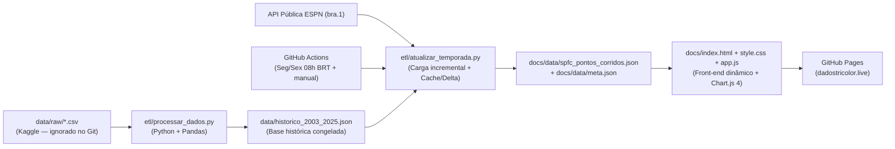

<div align="center">

# Dados Tricolor

**Painel interativo de análise estatística do São Paulo Futebol Clube no Campeonato Brasileiro na era dos pontos corridos (2003–Atual).**

[](https://github.com/YuriAlvvvss/SPFC-Analytics/actions/workflows/atualizar-jogos.yml)

[](https://dadostricolor.live/)
[](https://github.com/YuriAlvvvss/SPFC-Analytics/actions/workflows/atualizar-jogos.yml)
[](https://www.python.org/)
[](https://pandas.pydata.org/)
[](https://www.chartjs.org/)
[](#arquitetura)

[Acessar o painel (GitHub Pages)](https://dadostricolor.live/) · [Funcionalidades](#funcionalidades) · [Arquitetura](#arquitetura) · [Pipeline ETL](#qualidade-de-dados-e-etl) · [Como executar](#como-executar-localmente)

[](https://dadostricolor.live/)

</div>

---

## Sobre o Projeto

O **Dados Tricolor** é uma aplicação web **100% estática** — sem backend, publicada em produção no GitHub Pages ([dadostricolor.live](https://dadostricolor.live/)) — focada exclusivamente na trajetória do **São Paulo FC** no Campeonato Brasileiro Série A desde a implantação dos pontos corridos (**2003–Atual**).

Na **v2**, o projeto adota uma **arquitetura híbrida de dados com atualização automática**:
- **Base histórica congelada (2003–2025):** estruturada em **Python + Pandas** a partir dos CSVs públicos do Campeonato Brasileiro (Kaggle) e versionada em `data/historico_2003_2025.json`.
- **Carga incremental automatizada (2026+):** um pipeline em **Python + `requests`** executado periodicamente via **GitHub Actions** consulta a **API pública da ESPN (`bra.1`)**, importa apenas as partidas recém-finalizadas no exato schema da v1, mescla com o histórico congelado e atualiza `docs/data/spfc_pontos_corridos.json` e `docs/data/meta.json` para o front-end em **HTML5, CSS3 e JavaScript puro**.

---

## Resumo da Base Histórica Congelada (2003–2025)

| Indicador | Valor | Cobertura |
| --- | --- | --- |
| **Partidas analisadas** | **894 jogos** (23 temporadas) | 2003–2025 |
| **Campanha geral** | **396V · 246E · 252D** (`53,5%` de aproveitamento) | 2003–2025 |
| **Gols** | **1.259 GP · 969 GC** (Saldo **+290**) | 2003–2025 |
| **Disciplina (SPFC)** | **1.096 amarelos** (`2,40/J`) · **53 vermelhos** (`0,12/J`) | 2014–2025 (456 jogos) |
| **Gols detalhados** | **570 gols** (`563` de 117 atletas + `7` gols contra a favor) | 2014–2025 (456 jogos) |
| **Estatísticas técnicas** | Chutes, posse de bola, passes, faltas e escanteios | 379 jogos |

> **Temporada atual (`2026+`):** os jogos finalizados da edição em andamento são anexados dinamicamente a essa base congelada pelo pipeline automatizado do GitHub Actions (segundas e sextas-feiras às 08h BRT, além de disparo manual). Os totais ao vivo e a data/hora da última sincronização em horário de Brasília são exibidos diretamente no painel via `docs/data/meta.json`.

---

## Funcionalidades

### Front-end 100% Dinâmico e Filtros Combináveis
- **Limites e rótulos calculados automaticamente:** ano máximo, subtítulo, seletores `De`/`Até`, chips de período (`Todas`, `Tri 06–08`, `Com Gols/Cartões`, `Últimos 5 anos` e temporada atual), lista de adversários e textos de cobertura (`2014–YYYY`) se ajustam automaticamente a partir do JSON carregado — sem nenhum limite fixo de temporada.
- **Selo de atualização automática:** carrega `docs/data/meta.json` e exibe de forma discreta no cabeçalho e no rodapé a data e hora da última sincronização automática em horário de Brasília (`Atualizado automaticamente em DD/MM/AAAA às HH:MM`).
- **Adversário + Atalhos de Clássicos:** seleção dinâmica de qualquer adversário enfrentado na era dos pontos corridos (incluindo clubes inéditos da temporada atual, sem duplicatas) e pílulas rápidas para **Todos os Clássicos**, **Corinthians**, **Palmeiras** e **Santos**.
- **Mando de Campo:** controle segmentado `Todos` | `Casa` | `Fora`.
- **Responsividade inteligente:** barra de filtros fixa (`sticky`) no desktop e no fluxo normal da página no mobile para não cobrir os gráficos.

### Indicadores (KPIs)
- **Partidas** (total e divisão Casa/Fora), **Aproveitamento (%)** (com pontos conquistados vs. disputados), **Retrospecto V/E/D** (com barra proporcional), **Gols & Saldo** e **Disciplina**.
- **Cálculo rigoroso de disciplina:** as médias de cartões por jogo consideram **exclusivamente** partidas com cobertura disciplinar (`2014–Atual`) dentro do recorte filtrado, evitando distorções quando anos de `2003–2013` estão selecionados.
- **Tratamento completo de estados vazios:** combinações sem jogos retornam estados amigáveis, sem `NaN%` e sem erros de renderização nos gráficos.

### Gráficos Interativos (Chart.js 4)
1. **Evolução por Temporada / Rodada a Rodada:** barras empilhadas de V/E/D + linha de aproveitamento (%) com destaque ao Tricampeonato (`2006–2008`) e aba alternativa de **Gols Pró vs. Contra**. Clicar em qualquer temporada abre automaticamente a visão **Campanha Rodada a Rodada** daquele ano.
2. **Desempenho por Mando (Casa vs. Fora):** comparativo percentual de aproveitamento, vitórias e jogos sem sofrer gol (*clean sheets*), acompanhado de resumo numérico.
3. **Top 10 Artilheiros Dinâmico:** recalculado instantaneamente a partir dos gols de cada partida filtrada, diferenciando gols de bola rolando e pênaltis e excluindo gols contra da artilharia individual.
4. **Disciplina & Retrospecto por Adversário:** aba com evolução anual de amarelos/jogo e expulsões do SPFC (`2014–Atual`) e aba clicável com o aproveitamento frente aos adversários mais frequentes do recorte.

### Tabela de Partidas Filtradas
- Busca textual instantânea (adversário, artilheiro, estádio ou técnico), filtro rápido por resultado (`V`/`E`/`D`), ordenação por coluna, paginação configurável (`15`/`25`/`50`), cartões e linha do tempo de gols com minutos e marcações `(P)` e `(GC)`.

---

## Arquitetura



---

## Estrutura do Projeto

```text
SPFC-Analytics/
├── .github/
│   └── workflows/
│       └── atualizar-jogos.yml          # Automação agendada (Seg/Sex 08h BRT) e manual
├── data/
│   ├── historico_2003_2025.json         # Base histórica congelada (versionada no Git)
│   └── raw/                             # CSVs originais do Kaggle (ignorados no .gitignore)
│       └── .gitkeep
├── etl/
│   ├── processar_dados.py               # Pipeline histórico (Kaggle CSVs -> base 2003–2025)
│   └── atualizar_temporada.py           # Carga incremental da temporada atual via API ESPN
├── docs/                                # Raiz publicada pelo GitHub Pages
│   ├── CNAME                            # Domínio personalizado (dadostricolor.live)
│   ├── assets/
│   │   └── preview.png                  # Preview visual do painel
│   ├── index.html                       # Página principal do painel
│   ├── css/
│   │   └── style.css                    # Identidade visual Tricolor e layout responsivo
│   ├── js/
│   │   └── app.js                       # Estado reativo, filtros dinâmicos, Chart.js e tabela
│   └── data/
│       ├── spfc_pontos_corridos.json    # Dataset completo (2003–Atual) consumido pelo site
│       └── meta.json                    # Data/hora da última sincronização (BRT) e contagens
├── requirements.txt                     # Dependências leves para execução do ETL incremental
├── .gitignore
└── README.md
```

---

## Qualidade de Dados e ETL

### Pipeline Histórico ([`etl/processar_dados.py`](etl/processar_dados.py))
Aplica validações e correções específicas identificadas na inspeção dos arquivos originais do Kaggle (`2003–2025`):

- **Padronização de nomes:** os CSVs originais trazem os clubes sem acento (`Sao Paulo`, `Ceara`, `Gremio`, `Vitoria`). O ETL filtra `Sao Paulo` e padroniza todos os clubes com acentuação em português para exibição.
- **Ajuste de calendário (Edição 2020):** as 11 partidas finais do Brasileirão 2020 (rodadas 28 a 38), disputadas em janeiro e fevereiro de 2021 devido à pandemia, são atribuídas à temporada `2020`, preservando exatamente 38 jogos em 2020 e 38 em 2021.
- **Integração híbrida de cartões (2014–2025):** utiliza `campeonato-brasileiro-cartoes.csv` para **2014–2024** (mais completo, cobrindo 2014, 2024 e o 1º amarelo em expulsões por segundo amarelo) e faz *fallback* automático para `campeonato-brasileiro-estatisticas-full.csv` em **2025**. Para `2003–2013`, exporta `null` para evitar falsos zeros.
- **Artilharia limpa e dinâmica:** salva os gols dentro de cada partida (`2014–2025`), ordenados cronologicamente (incluindo acréscimos como `45+8` e `90+8`), unifica nomes duplicados entre temporadas (ex.: `Aldemir Ferreira` + `Ferreirinha` → `Ferreirinha`; `Diego Henrique Costa Barbosa` + `Diego Costa` → `Diego Costa`) e sinaliza gols contra a favor do SPFC (`gol_contra: true`) para não entrarem na artilharia individual.
- **Higienização textual:** remove espaços inseparáveis (`\xa0`) em nomes de estádios (ex.: `Morumbi`) e corrige problemas de codificação (*mojibake* UTF-8/Latin-1) em nomes de técnicos.

### Pipeline Incremental ([`etl/atualizar_temporada.py`](etl/atualizar_temporada.py))
Mantém a base atualizada na temporada corrente preservando 100% de compatibilidade com o schema da v1:

- **Carga incremental com cache/delta:** lê os jogos da temporada atual já presentes em `docs/data/spfc_pontos_corridos.json` e consulta o endpoint `/summary?event={id}` apenas para partidas novas ou sem detalhes — resultando em **0 chamadas extras a `/summary`** quando não há jogos novos (com suporte a `--force-refresh` para reprocessamento completo).
- **Normalização entre fontes (`MAPA_TIMES`, `MAPA_ATLETAS` e `MAPA_ARENAS`):** traduz os nomes retornados pela ESPN exatamente para o padrão do histórico congelado (ex.: `Athletico Paranaense` → `Athletico-PR`, `Red Bull Bragantino` → `Bragantino`, `Vasco da Gama` → `Vasco`; `Ferreira` → `Ferreirinha`), evitando duplicações nos filtros de adversários e no ranking de artilheiros.
- **Fuso horário e rodadas oficiais:** converte timestamps `UTC` da ESPN para `America/Sao_Paulo` (BRT), preservando a data e a hora reais das partidas no Brasil, e calcula a numeração oficial das 38 rodadas mesmo para jogos adiados fora de ordem cronológica.
- **Proteção *fail-safe* e gravação atômica:** qualquer falha da API ou regressão na contagem de partidas finalizadas encerra o script com código de erro (`exit 1`) sem sobrescrever `docs/data/spfc_pontos_corridos.json`. A gravação utiliza arquivo temporário (`.tmp` + `os.replace`) e só altera `docs/data/` quando há mudança real nos dados, evitando commits vazios no GitHub Actions.

---

## Como Executar Localmente

### 1. Visualizar o painel (sem precisar rodar o ETL)

Os arquivos JSON já estão versionados em `docs/data/`. Basta subir um servidor HTTP estático apontando para `docs/`:

```bash
git clone https://github.com/YuriAlvvvss/SPFC-Analytics.git
cd SPFC-Analytics
python -m http.server 8000 --directory docs
```

Depois acesse **`http://localhost:8000/`** no navegador.

> **Dica:** evite abrir `docs/index.html` diretamente via `file://`, pois navegadores bloqueiam chamadas `fetch()` para arquivos locais por política de CORS.

### 2. Executar a atualização incremental da temporada atual (API ESPN)

Instale as dependências e rode o script incremental:

```bash
pip install -r requirements.txt
python etl/atualizar_temporada.py
```

O script mescla `data/historico_2003_2025.json` com os jogos finalizados da temporada atual na ESPN, atualiza `docs/data/spfc_pontos_corridos.json` e `docs/data/meta.json` (apenas quando há alterações) e imprime o resumo da importação no terminal. Para ignorar o cache local e reconsultar todos os jogos da temporada atual, utilize `python etl/atualizar_temporada.py --force-refresh`.

### 3. Reprocessar a base histórica do Kaggle (opcional)

1. Baixe os CSVs do dataset **Campeonato Brasileiro de Futebol** no Kaggle e coloque-os em `data/raw/`:
   - `campeonato-brasileiro-full.csv`
   - `campeonato-brasileiro-cartoes.csv`
   - `campeonato-brasileiro-estatisticas-full.csv`
   - `campeonato-brasileiro-gols.csv`
2. Instale as dependências (além do `pandas`, utilizado exclusivamente no processamento dos CSVs históricos) e execute o script:

```bash
pip install -r requirements.txt pandas
python etl/processar_dados.py
```

---

## Publicação no GitHub Pages

1. Faça push da branch `main` com a pasta `docs/` atualizada.
2. No repositório do GitHub, acesse **Settings → Pages**.
3. Em **Build and deployment**, selecione **Source: Deploy from a branch**, escolha a branch **`main`** e a pasta **`/docs`**, e clique em **Save**.
4. Em **Actions**, o workflow [`atualizar-jogos.yml`](.github/workflows/atualizar-jogos.yml) roda automaticamente às **segundas e sextas-feiras às 08h BRT** (`cron: "0 11 * * 1,5"`) e também pode ser disparado manualmente via **`workflow_dispatch`**, mantendo [dadostricolor.live](https://dadostricolor.live/) atualizado sem intervenção manual.

---

## Fonte dos Dados

- **Histórico (2003–2025):** dataset público do **Campeonato Brasileiro de Futebol** disponível no [Kaggle](https://www.kaggle.com/datasets/adaoduque/campeonato-brasileiro-de-futebol). Os arquivos CSV originais não são versionados no repositório (ignorados via `.gitignore` em `data/raw/`), enquanto a base limpa congelada fica versionada em `data/historico_2003_2025.json`.
- **Temporada atual (`2026+`):** **API pública da ESPN (`bra.1`)**, consumida de forma incremental e automatizada via GitHub Actions.
