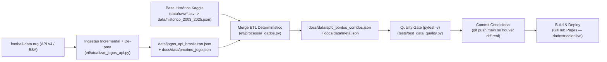

<div align="center">

# Dados Tricolor

**Painel interativo de análise estatística do São Paulo Futebol Clube no Campeonato Brasileiro na era dos pontos corridos (2003–Atual), combinando base histórica consolidada com atualização automática diária via API.**

**Acesso em produção:** [dadostricolor.live](https://dadostricolor.live/)

[](https://github.com/YuriAlvvvss/SPFC-Analytics/actions/workflows/data-quality.yml)
[](https://github.com/YuriAlvvvss/SPFC-Analytics/actions/workflows/atualizar-dados.yml)
[](https://github.com/YuriAlvvvss/SPFC-Analytics/actions/workflows/atualizar-jogos.yml)

[](https://dadostricolor.live/)
[](https://www.python.org/)
[](https://pandas.pydata.org/)
[](tests/test_data_quality.py)
[](https://www.chartjs.org/)

[Acessar o painel](https://dadostricolor.live/) · [Funcionalidades](#funcionalidades) · [Arquitetura e Pipeline Autônomo](#arquitetura-de-dados-e-pipeline-autônomo) · [Estrutura do Projeto](#estrutura-do-projeto) · [Como Executar](#como-executar-localmente) · [Fonte dos Dados](#fonte-dos-dados)

[](https://dadostricolor.live/)

</div>

---

## Sobre o Projeto

O **Dados Tricolor** é uma aplicação web **100% estática** — construída em **HTML5, CSS3, JavaScript puro e Chart.js 4** e publicada no GitHub Pages em [dadostricolor.live](https://dadostricolor.live/) — focada na trajetória do **São Paulo FC** no Campeonato Brasileiro Série A na era dos pontos corridos (**2003–Atual**).

O projeto opera com uma **arquitetura híbrida e um pipeline 100% autônomo protegido por testes automatizados**:
- **Base histórica congelada (2003–2025):** estruturada em **Python + Pandas** a partir dos CSVs públicos do Campeonato Brasileiro (Kaggle) e versionada em `data/historico_2003_2025.json`.
- **Pipeline autônomo diário via API (2026+):** executado automaticamente todos os dias às **03h00 BRT** no **GitHub Actions** ([`atualizar-dados.yml`](.github/workflows/atualizar-dados.yml)), consulta a API **`football-data.org` (v4 / `BSA`)** via `etl/atualizar_jogos_api.py`, grava jogos encerrados em `data/jogos_api_brasileirao.json` e a agenda do próximo confronto em `docs/data/proximo_jogo.json`, realiza o merge determinístico em `etl/processar_dados.py` e atualiza `docs/data/spfc_pontos_corridos.json` e `docs/data/meta.json` — com sincronização complementar via API pública da ESPN (`etl/atualizar_temporada.py`) para enriquecimento de eventos da temporada atual.
- **Quality Gate contínuo:** toda atualização automatizada ou push/PR na `main` passa pela suíte `pytest` em `tests/test_data_quality.py` antes de qualquer commit automático ou deploy no GitHub Pages.

---

## Resumo da Base Histórica Congelada (2003–2025)

| Indicador | Valor | Cobertura |
| --- | --- | --- |
| **Partidas analisadas** | **894 jogos** (23 temporadas) | 2003–2025 |
| **Campanha geral** | **396V · 246E · 252D** (`53,5%` de aproveitamento) | 2003–2025 |
| **Gols** | **1.259 GP · 969 GC** (Saldo **+290**) | 2003–2025 |
| **Disciplina (SPFC)** | **1.096 amarelos** (`2,40/J`) · **53 vermelhos** (`0,12/J`) | 2014–2025 (456 jogos) |
| **Gols detalhados** | **570 gols** (`563` de 117 atletas + `7` gols contra a favor) | 2014–2025 (456 jogos) |
| **Estatísticas técnicas** | Chutes, posse de bola, passes, faltas e escanteios | 379 jogos |

> **Temporada atual (`2026+`):** os jogos finalizados e o calendário do próximo confronto são atualizados automaticamente todos os dias às 03h00 BRT pelo pipeline autônomo do GitHub Actions (`football-data.org`), complementado pela sincronização da ESPN às segundas e sextas-feiras às 08h00 BRT (ambos também com disparo manual). Os totais atualizados e a data/hora da última sincronização em horário de Brasília são exibidos diretamente no painel via `docs/data/meta.json`.

---

## Funcionalidades

### Card de Próximo Jogo
Exibido no topo do painel com carregamento independente e não bloqueante a partir de `docs/data/proximo_jogo.json` (caso o arquivo esteja indisponível ou inválido, o card permanece oculto sem afetar o restante do dashboard):
- **Agenda automática do Brasileirão Série A:** apresenta competição e rodada (`Brasileirão Série A · Rodada X`), ordem do confronto (Mandante × Visitante com destaque visual ao São Paulo), badge de mando (`Casa` ou `Fora`), data formatada com dia da semana e horário em Brasília (`HHhMM (Brasília)`), com suporte a **`"Horário a definir"`** quando a CBF ainda não definiu o horário (`status: "SCHEDULED"` / `horario_definido: false`).
- **Selos temporais seguros:** calcula a contagem regressiva por data civil (`"Hoje"`, `"Amanhã"`, `"Em X dias"`) sem distorções de fuso horário, além do estado `"Aguardando atualização do resultado"` quando a data da partida já passou antes da próxima sincronização.
- **Resumo histórico e atalho `"Ver retrospecto"`:** calcula em memória o retrospecto acumulado contra o próximo adversário (`jogos · V · E · D · aproveitamento`) e oferece o botão **`Ver retrospecto contra <Adversário>`**, que aplica o filtro do clube sobre todo o período histórico, limpa busca/filtro rápido da tabela, sincroniza a URL (`URLSearchParams`), recalcula KPIs, Recordes/Streaks, gráficos e tabela e faz rolagem suave até os resultados.
- **Estados especiais tratados:** exibe botão desabilitado **`"Confronto inédito na base"`** para adversários sem jogos nos pontos corridos e uma faixa informativa **`"Nenhum jogo do Brasileirão agendado no momento"`** (com timestamp da verificação) durante entressafra ou fim de campeonato (`tem_proximo_jogo: false`).

### Filtros Dinâmicos e Compartilháveis via URL
- **Limites calculados a partir dos dados:** ano máximo, subtítulo, seletores `De`/`Até`, chips de período (`Todas`, `Tri (06–08)`, `Com Gols/Cartões`, `Últimos 5 anos` e temporada atual), lista de adversários (com atalhos para **Todos os Clássicos**, **Corinthians**, **Palmeiras** e **Santos**) e mando de campo (`Todos` | `Casa` | `Fora`) são populados dinamicamente.
- **Sincronização bidirecional via `URLSearchParams`:** alterar filtros atualiza a URL em tempo real via `history.replaceState` (omitindo parâmetros com valor padrão), e abrir uma URL parametrizada restaura automaticamente o recorte filtrado.
- **Fallback seguro:** parâmetros inválidos, temporadas inexistentes ou query strings malformadas são ignorados sem quebrar a renderização; se `de > ate`, o intervalo é normalizado automaticamente.
- **Botão de copiar link (`Copiar link`):** sincroniza o estado atual, copia a URL completa via Clipboard API (com fallback para ambientes sem permissão) e exibe confirmação visual (`Link copiado!`).
- **Parâmetros suportados na URL:**

| Parâmetro | Valores aceitos | Exemplo |
| --- | --- | --- |
| `de` / `ate` | Ano da temporada (`YYYY`) presente na base | `de=2006&ate=2008` |
| `adversario` | Nome do clube (aceita grafia sem acento/maiúsculas) ou `CLASSICOS` | `adversario=CLASSICOS` |
| `mando` | `Casa` ou `Fora` | `mando=Casa` |
| `resultado` | Filtro rápido da tabela (`V`, `E` ou `D`) | `resultado=V` |
| `busca` | Termo de busca na tabela (até 120 caracteres) | `busca=Luciano` |

Exemplo de link compartilhável (Tricampeonato contra clássicos como mandante):

```text
https://dadostricolor.live/?de=2006&ate=2008&adversario=CLASSICOS&mando=Casa
```

### Indicadores (KPIs)
- **Partidas** (total e divisão Casa/Fora), **Aproveitamento (%)** (pontos conquistados vs. disputados), **Retrospecto V/E/D** (com barra proporcional), **Gols & Saldo** e **Disciplina**.
- **Cálculo rigoroso de disciplina:** as médias de cartões por jogo consideram exclusivamente partidas com cobertura disciplinar (`2014–Atual`), evitando distorções quando anos de `2003–2013` estão no recorte.
- **Tratamento de estados vazios:** combinações sem jogos exibem mensagens claras, sem `NaN%` nem falhas de renderização.

### Recordes e Sequências (Streaks)
Seção recalculada dinamicamente em ordem cronológica a cada alteração nos filtros globais, exibindo o total de jogos analisados e 6 cards:
- **Maior Invencibilidade:** maior sequência sem derrotas (`V`/`E`), com período e indicador de marcas igualadas.
- **Maior Sequência de Vitórias:** maior série consecutiva de triunfos, com período e contagem de empates na marca.
- **Maior Jejum sem Vencer:** maior período consecutivo sem vitória (`E`/`D`).
- **Sequência Recente:** momento no encerramento do recorte (vitórias seguidas, jogos invicto, derrotas seguidas ou jejum), com destaque do último placar e adversário.
- **Maior Goleada a Favor:** vitória com maior saldo de gols (desempate por mais gols pró e data mais recente), exibindo placar, saldo, adversário, data e mando.
- **Pior Derrota:** derrota com pior saldo de gols (desempate por mais gols sofridos e data mais recente), exibindo placar, saldo, adversário, data e mando.

### Gráficos Interativos (Chart.js 4)
1. **Evolução por Temporada / Campanha Rodada a Rodada:** barras empilhadas de V/E/D + linha de aproveitamento (%) com destaque ao Tricampeonato (`2006–2008`) e aba **Gols Pró vs. Contra**. Clicar em qualquer ano alterna para a visão rodada a rodada.
2. **Desempenho por Mando (Casa vs. Fora):** comparativo percentual de aproveitamento, vitórias e jogos sem sofrer gol (*clean sheets*), com resumo numérico.
3. **Top 10 Artilheiros Dinâmico:** recalculado a partir dos gols de cada partida filtrada, diferenciando gols de bola rolando e pênaltis e excluindo gols contra da artilharia individual.
4. **Disciplina & Retrospecto por Adversário:** alternância entre a evolução anual de cartões (`2014–Atual`) e o aproveitamento frente aos até 15 adversários mais frequentes do recorte (com clique na barra para filtrar o clube).

### Comparador de Temporadas Lado a Lado
Módulo independente dos filtros globais (consulta sempre a base histórica completa), permitindo confrontar quaisquer duas campanhas:
- **Controles dedicados:** seletores de **Temporada A** e **Temporada B** (iniciando pelas duas edições mais recentes, com selo `★ Campeão` em `2006`, `2007` e `2008`), botão **Inverter (`⇄`)** e filtro próprio de mando (`Todos` | `Casa` | `Fora`).
- **Tabela comparativa com polaridade correta (12 indicadores + `Δ`):**
  - *Maior é melhor:* Pontos conquistados, Aproveitamento (%), Vitórias, Gols Pró, Média de Gols Pró/jogo, Saldo de Gols e Jogos sem sofrer gol (com taxa percentual).
  - *Menor é melhor (`↓`):* Derrotas, Gols Contra e Média de Gols Contra/jogo.
  - *Neutros:* Jogos disputados e Empates.
- **Resumo de vantagem e avisos contextuais:** contabiliza quantas métricas comparáveis cada temporada lidera e alerta quando a mesma temporada está selecionada nos dois lados (estado neutro `=`) ou quando há diferença no total de jogos entre as edições (ex.: 46 jogos em 2003–2004, 42 em 2005, 38 a partir de 2006 ou temporada em andamento).
- **Gráfico de Pontos Acumulados (Jogo a Jogo):** curva comparativa em **Chart.js 4** alinhada cronologicamente (`J1`, `J2`, ...), com interrupção natural da série mais curta (`null` / `spanGaps: false`) e tooltips exibindo placar, adversário, rodada e diferença de pontos naquele jogo.

### Tabela de Partidas Filtradas
- Busca textual instantânea (adversário, artilheiro, estádio, técnico ou temporada), filtro rápido por resultado (`V`/`E`/`D`), ordenação por coluna, paginação (`15`/`25`/`50`), cartões disciplinares e linha do tempo de gols com minutos e marcações `(P)` e `(GC)`.
- **Selo de sincronização:** exibe no cabeçalho e no rodapé a data/hora da última atualização automática em BRT lida de `docs/data/meta.json`.

---

## Arquitetura de Dados e Pipeline Autônomo

O projeto conta com um fluxo de dados **ponta a ponta e 100% autônomo** — da coleta na API ao deploy validado no GitHub Pages — preservando integralmente a base histórica original:



### Pilares Técnicos da Arquitetura
- **Base Híbrida e Imutabilidade do Dado Bruto:** os CSVs originais do Kaggle (`data/raw/*.csv`) e a base histórica congelada (`data/historico_2003_2025.json`) nunca são alterados pela ingestão da API. Jogos encerrados (`status == "FINISHED"` com placar `fullTime` válido) entram em `data/jogos_api_brasileirao.json` — ignorando partidas `IN_PLAY`, `PAUSED`, `POSTPONED`, `SUSPENDED` e `CANCELLED` e preservando temporadas anteriores. No merge determinístico (`mesclar_partidas_deterministico`), o ETL respeita ordem fixa de prioridade (**1º** histórico congelado `2003–2025`, **2º** jogos pós-histórico já enriquecidos em produção, **3º** jogos incrementais da API) e deduplica pelas chaves naturais `(temporada, rodada)`, `(data, adversario)`, `(temporada, mando, adversario)` e `data`, garantindo IDs únicos e ordenação cronológica estrita por `(temporada, data, id)`.
- **Fuso Horário e Normalização:** toda data `utcDate` da API é convertida de `UTC` para `America/Sao_Paulo` (`BRT`) antes da extração de data e hora, evitando erros de calendário em jogos noturnos (ex.: `00:30:00Z` torna-se `21:30` do dia anterior no Brasil; `TIMED 00:00:00Z` torna-se `21:00` do dia anterior). Para partidas futuras `SCHEDULED` em `00:00:00Z` (horário ainda não definido pela CBF), a data-base é preservada sem recuar um dia, gravando `hora: null` e `horario_definido: false`. Um dicionário explícito de de-para (`MAPA_TIMES_API`, com lookup tolerante a caixa e acentos) padroniza os clubes da `football-data.org` para a grafia exata da base histórica (ex.: `CA Mineiro` → `Atlético-MG`, `CA Paranaense` → `Athletico-PR`, `CR Vasco da Gama` → `Vasco`), complementado por `ESTADOS_TIMES` e `ARENAS_PADRAO_POR_CLUBE` para manter o schema v1 de 29 chaves consistente.
- **Idempotência Real (Zero Commits Fantasma):** tanto `etl/atualizar_jogos_api.py` (`incremental_alterado` e `proximo_jogo_alterado`) quanto `etl/processar_dados.py` (`_dataset_producao_alterado` e `sincronizar_meta_json`) comparam o conteúdo funcional ignorando apenas timestamps (`atualizado_em` / `gerado_em`) e utilizam gravação atômica (`.tmp` + `os.replace` com `allow_nan=False`). No GitHub Actions, o robô só commita, faz push e dispara `build` + `deploy` quando há mudança efetiva nos jogos encerrados ou na agenda do próximo jogo — evitando commits vazios diários.
- **Separação de Workflows (CI/CD):**
  - **[`.github/workflows/data-quality.yml`](.github/workflows/data-quality.yml) (CI/CD para pushes manuais e Pull Requests):** acionado em `push` e `pull_request` na `main` (e `workflow_dispatch`), encadeando `data-quality` (`pytest -v`) → `build` (empacota `./docs`, apenas em `push` na `main`) → `deploy` (publica no ambiente `github-pages`, apenas em `push` na `main`).
  - **[`.github/workflows/atualizar-dados.yml`](.github/workflows/atualizar-dados.yml) (Pipeline Autônomo Agendado + Deploy):** acionado diariamente via `cron: "0 6 * * *"` (**03h00 BRT**) e sob demanda via `workflow_dispatch`, em 3 jobs encadeados:
    1. **`update-data`:** valida o Secret `FOOTBALL_DATA_API_KEY` (*fail-fast*), executa `python etl/atualizar_jogos_api.py`, roda `python etl/processar_dados.py`, aplica o Quality Gate (`pytest -v`), verifica alterações reais nos 4 JSONs de dados (`data/jogos_api_brasileirao.json`, `docs/data/spfc_pontos_corridos.json`, `docs/data/meta.json` e `docs/data/proximo_jogo.json`) e só executa commit, `git pull --rebase` e push para `main` quando `has_changes == 'true'`.
    2. **`build`** (`needs: update-data`, `if: has_changes == 'true'`): faz checkout da `main` atualizada e empacota `./docs` como artefato do GitHub Pages.
    3. **`deploy`** (`needs: build`): publica o artefato validado no ambiente `github-pages` (`dadostricolor.live`).
  - **[`.github/workflows/atualizar-jogos.yml`](.github/workflows/atualizar-jogos.yml) (Sincronização Complementar — ESPN):** agendado às segundas e sextas-feiras às 08h00 BRT (`cron: "0 11 * * 1,5"`) e sob demanda; executa `etl/atualizar_temporada.py`, roda `pytest -v` e commita `docs/data/` apenas quando há alteração real.

### Componentes do ETL e Qualidade de Dados

#### 1. Ingestão Incremental via API ([`etl/atualizar_jogos_api.py`](etl/atualizar_jogos_api.py))
- Consulta `GET https://api.football-data.org/v4/competitions/BSA/matches` em uma única requisição HTTP (autenticada via variável de ambiente `FOOTBALL_DATA_API_KEY`, com suporte opcional a `--season YYYY` e tratamento explícito para `401`, `403`, `429`, `5xx` e falhas de rede).
- Filtra partidas do São Paulo FC, normaliza fuso horário (`UTC → BRT`) e nomes de clubes, grava `data/jogos_api_brasileirao.json` (apenas `FINISHED` válidos) e seleciona o próximo jogo futuro (`status in ("TIMED", "SCHEDULED")`) em `docs/data/proximo_jogo.json`.

#### 2. ETL Histórico e Merge Determinístico ([`etl/processar_dados.py`](etl/processar_dados.py))
Processa os CSVs originais do Kaggle (`2003–2025`) ou utiliza automaticamente a base histórica congelada (`data/historico_2003_2025.json`) quando `pandas` ou `data/raw/*.csv` não estão presentes, fazendo o merge determinístico com `data/jogos_api_brasileirao.json` (continuando 100% funcional offline quando o arquivo da API não existe):
- **Patch documentado de datas (`CORRECOES_DATAS_POR_ID`):** corrige no próprio pipeline duas anomalias de datas duplicadas da fonte original do Kaggle, **sem alterar os arquivos brutos em `data/raw/`**:
  - ID `2417` (2008 R11, Casa vs Palmeiras): `2008-07-06` → `2008-07-13`.
  - ID `3130` (2010 R5, Fora vs Guarani): `2010-05-23` → `2010-05-30`.
  - A flag `--patch-json` aplica o patch e o merge diretamente sobre `data/historico_2003_2025.json` sem exigir os CSVs do Kaggle nem `pandas`.
- **Padronização e higiene:** acentua nomes de clubes, unifica nomes de atletas entre temporadas e súmulas (ex.: `Aldemir Ferreira` → `Ferreirinha`; `Diego Henrique Costa Barbosa` → `Diego Costa`), sinaliza gols contra a favor (`gol_contra: true`), remove `\xa0` em estádios e corrige *mojibake* UTF-8/Latin-1 em técnicos.
- **Calendário 2020 e cobertura híbrida de cartões:** atribui as 11 rodadas finais da edição 2020 (disputadas em jan–fev/2021) à temporada `2020`; usa `campeonato-brasileiro-cartoes.csv` para `2014–2024` com fallback para `campeonato-brasileiro-estatisticas-full.csv` em `2025` e `null` para `2003–2013`.

#### 3. ETL Complementar via ESPN ([`etl/atualizar_temporada.py`](etl/atualizar_temporada.py))
Atualiza a temporada corrente (`2026+`) via API pública da ESPN (`bra.1`) preservando 100% do schema histórico:
- **Cache/Delta:** consulta `/summary?event={id}` apenas para partidas novas ou incompletas (suporta `--force-refresh` para reconsulta total), enriquecendo a temporada atual com artilheiros, cartões e estatísticas técnicas.
- **Normalização e proteção *fail-safe*:** mapeia clubes, atletas e estádios (`MAPA_TIMES`, `MAPA_ATLETAS`, `MAPA_ARENAS`), converte datas para `America/Sao_Paulo` (BRT), aborta em caso de falha da API ou regressão na contagem de partidas e grava `docs/data/spfc_pontos_corridos.json` e `docs/data/meta.json` de forma atômica.

#### 4. Testes de Qualidade de Dados ([`tests/test_data_quality.py`](tests/test_data_quality.py))
Suíte automatizada em **`pytest`** (100% offline) que valida `docs/data/spfc_pontos_corridos.json`, `data/historico_2003_2025.json`, `docs/data/meta.json`, `docs/data/proximo_jogo.json` e a lógica dos módulos de ETL:

| Categoria | Validações executadas |
| --- | --- |
| **Integridade de arquivos** | Existência, tamanho `> 0`, UTF-8 limpo (sem BOM ou `U+FFFD`), JSON estrito (rejeita `NaN`/`Infinity`) e estrutura raiz (`metadata` + `partidas`). |
| **Schema e nulos** | Presença exata de todas as chaves de `metadata`, `meta.json` e das 29 chaves de cada partida; nenhum campo obrigatório nulo, vazio ou `NaN`; cobertura obrigatória de gols e cartões na era moderna histórica (`2014–2025`) e coerência de tipos em temporadas posteriores (`2026+`). |
| **Regras de domínio do futebol** | Datas `YYYY-MM-DD` e horas `HH:MM` entre `2003` e hoje (incluindo a exceção da temporada `2020` em jan–fev/2021), ordenação cronológica por `(temporada, data, id)`, limites de rodadas por edição (46 em 2003–2004, 42 em 2005, 38 em 2006+), UFs válidas e consistentes por clube, ausência de duplicatas ortográficas ou SPFC contra si mesmo, higiene de strings e faixas válidas de cartões/estatísticas (`chutes_no_alvo <= chutes`, percentuais `0..100`). |
| **Coerência de placar e gols** | `gols_pro` e `gols_contra` inteiros `>= 0` batendo exatamente com `saldo_gols`, `resultado` (`V`/`E`/`D`) e `pontos` (`3`/`1`/`0`); quando `gols` está presente, `len(gols) == gols_pro`, minutos válidos em ordem cronológica e coerência entre `tipo` e `gol_contra`. |
| **Unicidade e consistência cruzada** | Sem duplicidade por `id`, `(temporada, rodada)`, `(data, adversario)` ou `(temporada, mando, adversario)`; no máximo 1 jogo do SPFC por data; integridade entre `metadata`, `docs/data/meta.json` e preservação intacta do histórico `2003–2025` no arquivo de produção. |
| **Testes offline da API e Próximo Jogo** | Conversão `UTC → America/Sao_Paulo` (jogos noturnos, `TIMED 00:00:00Z` e preservação de data em `SCHEDULED 00:00:00Z`), de-para `MAPA_TIMES_API`, exclusão de status em andamento/adiados, seleção do próximo jogo e validação do schema de `docs/data/proximo_jogo.json` (inclusive fim de campeonato `tem_proximo_jogo=False`), merge determinístico/idempotente offline e proteção contra commits fantasma. |

---

## Estrutura do Projeto

```text
SPFC-Analytics/
├── .github/
│   └── workflows/
│       ├── atualizar-dados.yml          # Pipeline autônomo diário (03h BRT): API -> ETL -> pytest -> deploy
│       ├── atualizar-jogos.yml          # Sincronização complementar via API ESPN (Seg/Sex 08h BRT) + Quality Gate
│       └── data-quality.yml             # Pipeline CI/CD (push/PR na main): data-quality -> build -> deploy
├── data/
│   ├── historico_2003_2025.json         # Base histórica congelada (versionada no Git)
│   ├── jogos_api_brasileirao.json       # Base incremental de jogos encerrados via football-data.org (v4 / BSA)
│   └── raw/                             # CSVs originais do Kaggle (ignorados no .gitignore)
│       └── .gitkeep
├── docs/                                # Raiz empacotada e publicada no GitHub Pages
│   ├── CNAME                            # Domínio personalizado (dadostricolor.live)
│   ├── assets/
│   │   └── preview.png                  # Preview visual do painel
│   ├── css/
│   │   └── style.css                    # Identidade visual Tricolor e layout responsivo
│   ├── data/
│   │   ├── meta.json                    # Metadados da última sincronização (BRT) e contagens
│   │   ├── proximo_jogo.json            # Agenda do próximo jogo do SPFC (consumido pelo Card de Próximo Jogo)
│   │   └── spfc_pontos_corridos.json    # Dataset de produção (2003–Atual) consumido pelo site
│   ├── index.html                       # Página principal do painel
│   └── js/
│       └── app.js                       # Próximo jogo, filtros/URL, streaks, comparador, Chart.js 4 e tabela
├── etl/
│   ├── atualizar_jogos_api.py           # Ingestão incremental via football-data.org v4 + proximo_jogo.json
│   ├── atualizar_temporada.py           # Carga incremental complementar via API ESPN (gols, cartões e stats)
│   └── processar_dados.py               # ETL histórico (Kaggle CSVs), patch de datas e merge determinístico
├── tests/
│   └── test_data_quality.py             # Suíte pytest de qualidade, integridade e testes offline do pipeline
├── .gitignore
├── README.md
└── requirements.txt                     # Dependências Python (requests e pytest)
```

---

## Como Executar Localmente

### 1. Clonar o repositório e instalar dependências

```bash
git clone https://github.com/YuriAlvvvss/SPFC-Analytics.git
cd SPFC-Analytics
pip install -r requirements.txt
```

### 2. Execução 100% Offline (ETL + Quality Gate + Front-end)

Todos os JSONs de produção já estão versionados em `docs/data/`, e tanto o merge ETL quanto a suíte de testes rodam **100% offline** sem precisar de chave de API nem de `pandas`:

```bash
# 1. Executar o merge determinístico e sincronização offline (usa historico_2003_2025.json + jogos_api_brasileirao.json)
python3 etl/processar_dados.py

# 2. Executar a suíte completa de qualidade de dados e testes offline do pipeline
pytest -v

# 3. Subir o servidor HTTP local para visualizar o painel
python3 -m http.server 8000 --directory docs
```

Acesse **`http://localhost:8000/`** no navegador.

> **Por que usar um servidor HTTP local?** Abrir `docs/index.html` diretamente via `file://` faz navegadores bloquearem chamadas `fetch()` por política de CORS. Servir em `http://localhost:8000` (contexto seguro) garante tanto o carregamento dos datasets (`spfc_pontos_corridos.json`, `meta.json` e `proximo_jogo.json`) quanto o funcionamento completo da sincronização de URL (`URLSearchParams` / `history.replaceState`) e do botão **Copiar link** (Clipboard API).

### 3. Configurar e Executar a Atualização via API (`football-data.org`)

Para coletar os jogos mais recentes e atualizar `docs/data/proximo_jogo.json` localmente, defina a variável de ambiente `FOOTBALL_DATA_API_KEY` (nunca salve chaves reais em arquivos versionados):

**Linux / macOS:**

```bash
export FOOTBALL_DATA_API_KEY="SUA_CHAVE_AQUI"
python3 etl/atualizar_jogos_api.py
python3 etl/processar_dados.py
pytest -v
```

**Windows (PowerShell):**

```powershell
$env:FOOTBALL_DATA_API_KEY="SUA_CHAVE_AQUI"
python etl/atualizar_jogos_api.py
python etl/processar_dados.py
pytest -v
```

> **Dica:** para consultar uma edição específica, utilize `python3 etl/atualizar_jogos_api.py --season 2026`.

#### Configurar o Secret no GitHub Actions (Pipeline Autônomo)
Para que o workflow [`.github/workflows/atualizar-dados.yml`](.github/workflows/atualizar-dados.yml) execute automaticamente no seu repositório ou fork:
1. Acesse **Settings → Secrets and variables → Actions** no GitHub.
2. Clique em **New repository secret**.
3. Defina o nome exato **`FOOTBALL_DATA_API_KEY`** e cole a sua chave da [football-data.org](https://www.football-data.org/).
4. O workflow validará o segredo em modo *fail-fast* antes de consultar a API, rodando diariamente às **03h00 BRT** ou manualmente em **Actions → Atualizar Dados do Brasileirão (API + Deploy) → Run workflow**.

### 4. Outras Rotinas de ETL (Opcionais)

- **Sincronização complementar via API pública da ESPN (gols, cartões e estatísticas da temporada atual):**

```bash
python3 etl/atualizar_temporada.py
# Opcional: reconsultar todos os jogos da temporada atual ignorando o cache local
python3 etl/atualizar_temporada.py --force-refresh
```

- **Aplicar explicitamente o patch de datas sobre a base histórica versionada (sem exigir `pandas` nem CSVs do Kaggle):**

```bash
python3 etl/processar_dados.py --patch-json
```

- **Reprocessar toda a base histórica a partir dos CSVs do Kaggle:**
  1. Baixe os 4 CSVs do dataset do Kaggle e coloque-os em `data/raw/`:
     - `campeonato-brasileiro-full.csv`
     - `campeonato-brasileiro-cartoes.csv`
     - `campeonato-brasileiro-estatisticas-full.csv`
     - `campeonato-brasileiro-gols.csv`
  2. Instale o `pandas` e execute o pipeline histórico:

```bash
pip install -r requirements.txt pandas
python3 etl/processar_dados.py
```

---

## Fonte dos Dados

- **Histórico (2003–2025):** dataset público do **Campeonato Brasileiro de Futebol** disponível no [Kaggle](https://www.kaggle.com/datasets/adaoduque/campeonato-brasileiro-de-futebol). Os CSVs originais não são versionados no repositório (ignorados via `.gitignore` em `data/raw/`), enquanto a base limpa congelada fica versionada em `data/historico_2003_2025.json`.
- **Temporada atual (`2026+`) e Próximo Jogo (pipeline autônomo diário):** **API [football-data.org](https://www.football-data.org/) (v4 — competição `BSA`)**, consumida diariamente via GitHub Actions para ingestão incremental de partidas encerradas (`data/jogos_api_brasileirao.json`) e atualização da agenda do próximo confronto (`docs/data/proximo_jogo.json`).
- **Enriquecimento detalhado (`2026+`):** **API pública da ESPN (`bra.1`)**, consumida de forma incremental via `etl/atualizar_temporada.py` para detalhamento de gols, cartões e estatísticas técnicas das partidas recentes.
